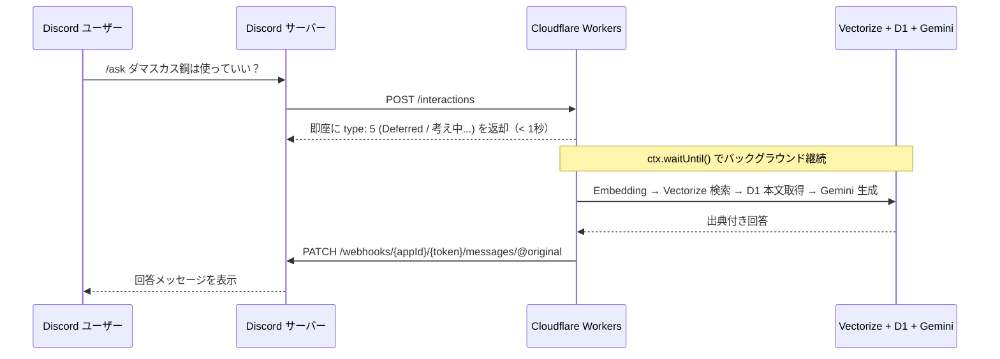

# 01. Cloudflare Workers / Hono / D1 / Static Assets 解説

> 関連リポジトリ: [ai-travel-planner](https://github.com/Ono-L/ai-travel-planner) / [gbf-beginner-bot](https://github.com/Ono-L/gbf-beginner-bot)

---

## 1. Cloudflare Workers（エッジランタイム）とは？

### 一言でいうと
従来のサーバー（EC2 や VPS で 24 時間 Linux を立ち上げる方式）と違い、**世界中に分散した Cloudflare のサーバー（エッジ）上で、リクエストが来た瞬間だけ JavaScript / TypeScript を高速実行するサーバーレス基盤**です。

### なぜ Node.js の `fs` や `crypto` を使えないのか？
- Cloudflare Workers は Node.js ではなく、Chrome と同じ **V8 エンジン（Web 標準 API ベース）** の軽量な分離環境（V8 Isolate）で動きます。
- そのため、ローカルディスクを読む `fs` や OS プロセスを起動する `child_process` などの Node.js 固有モジュールは原則使えません。
- 代わりに **`fetch()`・`Request` / `Response`・`crypto.subtle`（Web Crypto API）** といったブラウザと共通の Web 標準 API を使います。
- **自分のプロジェクトでの実践例**:
  - `ai-travel-planner/apps/api/src/services/session-auth.ts` では、Node.js の `crypto` を使わず **`crypto.subtle`** だけで HMAC-SHA256 署名と SHA-256 ハッシュ比較を実装しています。

---

## 2. Workers Static Assets でフロント＋API を 1 つにまとめる理由

`ai-travel-planner` では、`wrangler.jsonc` に以下を設定しています：

```jsonc
"assets": {
  "directory": "../web/dist",
  "binding": "ASSETS",
  "not_found_handling": "single-page-application"
}
```

### 主なメリット
1. **同一オリジンになるため CORS の煩雑さを減らせる**: フロントエンド（React）と API（`/api/*`）が同じドメインから配信されるため、Cookie 認証（`HttpOnly` / `SameSite=Lax`）もシンプルかつ安全に動きます。
2. **運用コスト \$0 & 管理対象が 1 つ**: フロント用の別ホスティングとバックエンド用の別サーバーを分けて管理する必要がなく、Cloudflare 無料枠 1 つで完結します。
3. **SPA ルーティング対応**: `not_found_handling: "single-page-application"` により、存在しないパスにアクセスされても React の `index.html` を返せます。

---

## 3. Hono + Zod + Hono RPC によるエンドツーエンド型安全

### Hono とは？
Cloudflare Workers のようなエッジランタイム向けに設計された、超軽量・高速な TypeScript Web フレームワークです（Express のモダン・エッジ版のような立ち位置）。

### Zod バリデーションとは？
TypeScript の型（`interface` / `type`）は **コンパイル時だけ** のチェックであり、実行時に外部から飛んでくる JSON が正しいかは保証してくれません。
そこで **`@hono/zod-validator` + `zod`** を使うと：
- 実行時に「必須項目があるか」「文字数や数値が妥当か」を厳格にチェックできる
- 不正データなら自動で `400 Bad Request` を返せる
- 検証済みのデータ（`c.req.valid('json')`）に自動で正しい TypeScript 型がつく

### Hono RPC の強み
- API 側で `export type AppType = typeof routes;` とルート定義の型をエクスポートすると、フロントエンド側は `hc<AppType>()` を使って **API の URL・リクエスト引数・レスポンス型をすべて補完・型チェック** できます。
- バックエンドのフィールド名を変えた瞬間にフロント側でコンパイルエラーが出るため、仕様ズレによるバグを未然に防げます。

---

## 4. Cloudflare D1 と Prepared Statement（SQL インジェクション対策）

### Cloudflare D1 とは？
Cloudflare のエッジ上で動く **SQLite 互換のサーバーレス RDB** です。

### なぜ Prepared Statement が必須なのか？
悪い例（文字列結合）：
```ts
// NG: 入力に "' OR '1'='1" を入れられると SQL 自体が改ざんされる
const sql = `SELECT * FROM sdd_tasks WHERE id = '${taskId}'`;
```

良い例（Prepared Statement / パラメータバインド）：
```ts
// OK: SQL の構造と「データ（?）」を分離して渡すため、SQL として解釈されない
await c.env.DB.prepare(
  'UPDATE sdd_tasks SET ai_review_summary = ? WHERE id = ?'
).bind(summary, taskId).run();
```

`ai-travel-planner` と `gbf-beginner-bot` のすべての DB 操作で、この `.prepare(...).bind(...)` を徹底しています。

---

## 5. `ctx.waitUntil()` — レスポンス返却後の非同期処理

### なぜ必要か？
通常の Cloudflare Workers は、**HTTP レスポンスを返した瞬間に処理が打ち切られます**。
しかし `gbf-beginner-bot` が相手にする Discord Interactions には **「3 秒以内に初期応答を返さないとタイムアウトエラーになる」** という厳しい制約があります。

### 解決フロー（`gbf-beginner-bot` の `/ask`）


- `ctx.waitUntil(promise)` に非同期処理を渡すことで、**3 秒以内に応答を返しつつ、裏側で RAG 推論〜Webhook 更新まで確実に完了させる**ことができます。

---

## 復習チェック質問（自分の言葉で説明してみよう）
1. なぜ Cloudflare Workers では Node.js の `fs` や `crypto` を使えないのか？代わりに何を使うか？
2. `Workers Static Assets` でフロントと API を 1 つにまとめるメリットを 2 つ挙げよ。
3. TypeScript を使っているのに、なぜ実行時バリデーション（Zod）が必要なのか？
4. Discord Bot の `/ask` で `ctx.waitUntil()` を使わなかったら何が起きるか？
