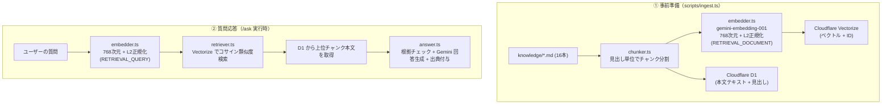

# 02. RAG（検索拡張生成）・Embedding・Vectorize 解説

> 関連リポジトリ: [gbf-beginner-bot](https://github.com/Ono-L/gbf-beginner-bot)

---

## 1. RAG（Retrieval-Augmented Generation）とは？

### 一言でいうと
LLM（Gemini 等）に「頭の中の記憶」だけで答えさせるのではなく、**質問に関連する手元の信頼できるドキュメントを先に検索（Retrieval）し、その文章をプロンプトに添えて回答を生成（Generation）させる仕組み**です。

### なぜ RAG を使うのか？
1. **ハルシネーション（もっともらしい嘘）を減らせる**: 根拠となる自前ナレッジだけを参照させるため、古い情報やデタラメを混ぜにくい。
2. **モデルの再学習（ファインチューニング）が不要**: Markdown ファイル（`knowledge/*.md`）を書き換えて再投入するだけで最新知識に更新できる。
3. **出典を明示できる**: 「どのファイルのどの見出しを参照したか」をユーザーに提示できる。

---

## 2. `gbf-beginner-bot` の RAG パイプライン全体像

RAG は大きく **① 事前準備（Ingest）** と **② 質問応答（Query）** の 2 フェーズに分かれます。

### なぜ Vectorize と D1 に分けているのか？
- **Cloudflare Vectorize**: 「ベクトル同士の近さ（類似度）を高速に探す」専用インデックス。大きな本文テキストを丸ごと入れるより、メタデータと ID だけに絞る方が軽く管理しやすい。
- **Cloudflare D1**: 検索でヒットしたチャンク ID に対応する「本文・見出し・ファイル名」を確実に保管する RDB。
- この責務分離により、低コストかつ高速に RAG を動かせます。

---

## 3. Embedding・768 次元・L2 正規化・`taskType` の仕組み

### Embedding（埋め込みベクトル）とは？
文章の意味を **数値の配列（ベクトル）** に変換したものです。意味が近い文章同士は、空間上で「同じ方向」を向くようになります。

### なぜ `outputDimensionality: 768` + **L2 正規化** をするのか？
1. **次元数の制約**: `gemini-embedding-001` のデフォルト出力は 3072 次元ですが、Cloudflare Vectorize の次元上限・ストレージ効率を考慮し **768 次元** に縮小して出力しています（Matryoshka Representation Learning により先頭 768 次元でも高い意味表現を維持できます）。
2. **なぜ L2 正規化（`normalizeL2`）が必須なのか？**
   - Gemini API はデフォルトの 3072 次元のときは正規化済みですが、**次元数を縮小（768 次元等）した出力はベクトルの長さ（ノルム）が 1 になりません**。
   - すべてのベクトルを長さ 1 に揃える処理が **L2 正規化** です：
     $$\hat{v} = \frac{v}{\|v\|_2} = \frac{v}{\sqrt{\sum_i v_i^2}}$$
   - 長さを 1 に揃えることで、コサイン類似度（内積）が純粋に「意味の向きの近さ」だけを正確に測れるようになります。

### なぜ `RETRIEVAL_DOCUMENT` と `RETRIEVAL_QUERY` を使い分けるのか？
- 検索対象の「解説記事（Document）」と、ユーザーの短い「質問文（Query）」は文章の性質が異なります。
- 登録時は `taskType: "RETRIEVAL_DOCUMENT"`、検索時は `taskType: "RETRIEVAL_QUERY"` を指定することで、Gemini の Embedding モデルが「質問と回答記事がマッチしやすい空間」へ最適化してくれます。

---

## 4. ハルシネーションを防ぐ 3 重ガード（`src/rag/answer.ts`）

LLM にそのまま聞くと、ナレッジに載っていないことも知ったかぶりで答えてしまいます。`gbf-beginner-bot` では以下の **3 段階** で防いでいます。

1. **第 1 ガード（類似度フィルタ）**: `retriever.ts` でスコアが閾値未満の無関係なチャンクを除外する。
2. **第 2 ガード（0 件ショートサーキット）**: 根拠チャンクが 0 件なら **そもそも LLM を呼ばず**、「手元のナレッジに載っていないのでゲーム内お知らせ等を確認してほしい」という定型文を返す（API コストも削減）。
3. **第 3 ガード（`[[NO_EVIDENCE]]` マーカー）**: チャンクがヒットしても質問の答えが本文に無ければ、LLM に推測させず専用文字列 `[[NO_EVIDENCE]]` を返させ、コード側で検知して定型文へ差し替える。
4. **出典の強制付与**: LLM に出典を書かせるとファイル名を捏造することがあるため、**システムコード側（`formatCitations`）で確実に参照見出しとファイル名を末尾へ添付**しています。

---

## 5. 可用性を高めるモデル自動フォールバック

`src/rag/answer.ts` の `createGeminiTextGenerator` では：
- 1 リクエストに **15 秒タイムアウト**（`AbortSignal.timeout(15_000)`）を設定。
- メインモデルが `404`（モデル廃止）/ `429`（レート制限）/ `5xx`（一時混雑）またはタイムアウトを返した場合、**フォールバックモデル候補へ自動切替**して応答を継続します。
- また、Gemini のレスポンスに `thought: true`（思考過程パート）が含まれる場合はフィルタ除外し、回答本文だけを安全に取り出しています。

---

## 復習チェック質問（自分の言葉で説明してみよう）
1. なぜ Embedding を 768 次元に下げたときに L2 正規化が必要なのか？
2. `RETRIEVAL_DOCUMENT` と `RETRIEVAL_QUERY` を使い分ける理由は？
3. ハルシネーションを防ぐための 3 段階の仕組みを説明せよ。
4. なぜ出典欄を LLM ではなくアプリケーションコード側で生成しているのか？
