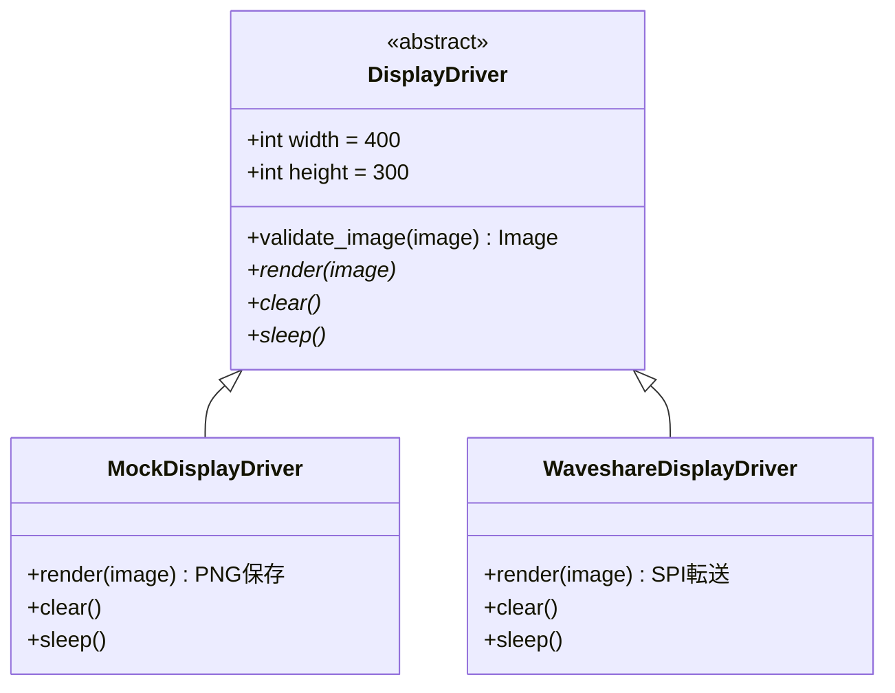

# 04. Python 3.12 / FastAPI / Pydantic v2 / 電子ペーパー設計解説

> 関連リポジトリ: [epaper-dashboard](https://github.com/Ono-L/epaper-dashboard)

---

## 1. FastAPI + Pydantic v2 + Python 3.12 型ヒント

### FastAPI とは？
Python の **型ヒント（Type Hints）をそのまま API の入力検証・レスポンス変換・Swagger (OpenAPI) ドキュメント自動生成に活かせる** モダンな非同期 Web フレームワークです。

### Pydantic v2（`BaseModel` / `BaseSettings`）の役割
- **`BaseModel`（`src/models.py`）**:
  - 通知リクエスト（`app_name`, `title`, `body`）や天気情報（`WeatherInfo`）の構造と制約（必須項目・文字長・型）を宣言的に定義。
  - 不正な JSON が来たら FastAPI が自動で `422 Unprocessable Entity` を返します。
- **`BaseSettings`（`src/config.py`）**:
  - `.env` ファイルや環境変数（`API_KEY`, `DISPLAY_MODE`, `LATITUDE` など）を型安全に読み込み、設定値の型ミスを起動時にすぐ検知できます。
- **FastAPI の `Depends`（依存性注入 / DI）**:
  - `src/api/dependencies.py` で `verify_api_key` や `get_notification_repo` を切り出しており、ルーター側に認証ロジックを重複させず、テスト時の差し替えも容易にしています。

---

## 2. ドライバ抽象化（抽象基底クラス + Factory パターン）

### なぜ抽象化したのか？
電子ペーパー実機（Raspberry Pi Zero 2 W + Waveshare 4.2inch SPI）は、ハードウェアの調達・配線・SPI 有効化が終わるまで手元で画面を出せません。
もし描画コードの中に実機ドライバの呼び出しを直書きしてしまうと、**Mac 上でレイアウト調整や自動テストができなくなります**。

### 解決した設計（`src/display/`）

1. **描画エンジン（`renderer.py`）**: 「データ → 400×300 の 1bit モノクロ `PIL.Image` を作る」責務だけに専念。
2. **抽象基底クラス（`base.py` の `DisplayDriver`）**: 共通の `validate_image()` で「サイズ 400×300 か？ 1bit モノクロ（モード `"1"`）か？」を強制チェックし、不正サイズなら `ValueError` で落とす。
3. **具象ドライバ（`mock.py` / `waveshare.py`）**:
   - `DISPLAY_MODE=mock`: `output/preview.png` へ保存し、ブラウザ `/preview` で即時確認可能。
   - `DISPLAY_MODE=waveshare`: 実機の SPI へ出力（実機ライブラリ未導入の Mac 上で誤って呼ばれると明示的な `RuntimeError` を出す）。
4. **Factory（`factory.py`）**: 環境変数 `DISPLAY_MODE` を見てどちらのドライバを生成するか切り替え。

→ これにより **実機移行時に描画ロジックや API コードを 1 行も変えずに差し替えられる** 設計（開放閉鎖原則：OCP）を実現しています。

---

## 3. 電子ペーパーと 1bit モノクロ描画（Pillow モード `"1"`）

### 通常のディスプレイとの違い
- 一般的な PC 画面は RGB 各 8bit（計 24bit・約 1,677 万色）ですが、白黒電子ペーパーは **1 ピクセルあたり 1bit（白 `255` か黒 `0` の 2 値のみ）** です。
- そのため、グレースケールやアンチエイリアスのぼかしが潰れやすく、**視認性の高い太字・明確な罫線・適切な日本語折り返し幅の計算**が重要になります。
- `epaper-dashboard` では、Docker コンテナに日本語フォント（IPAex ゴシック）を組み込み、`Image.new("1", (400, 300), 255)` で直接 1bit キャンバスへ描画しています。

---

## 4. 外部 API 障害に強い設計とモックテスト

### 天気 API のフォールバック（`src/services/weather.py`）
- 外部の Open-Meteo API はネットワーク障害や一時的なタイムアウトが起こり得ます。
- もし例外をそのまま放置すると、**天気が取れないだけで時計や iPhone 通知まで画面全体が更新できなくなる**恐れがあります。
- そこで例外をキャッチして `WeatherInfo(condition="取得失敗", is_fallback=True, ...)` を返すことで、**部分障害でもダッシュボード全体が落ちない（グレースフル・デグラデーション）** ようにしています。

### テストでの外部通信モック（`httpx.MockTransport`）
- `tests/test_weather_service.py` では、テスト実行時に本物の Open-Meteo へアクセスせず `httpx.MockTransport` を使って：
  - 正常 JSON レスポンスのパース検証
  - `httpx.ConnectError` 発生時に例外で落ちず `is_fallback=True` が返ることの検証
  をオフラインかつ高速に自動テストしています。

---

## 復習チェック質問（自分の言葉で説明してみよう）
1. `DisplayDriver` を抽象基底クラスで分離したことによるメリットは？
2. `MockDisplayDriver` で不正サイズの画像を渡したとき、どこでどう防いでいるか？
3. 外部 API（Open-Meteo）が落ちたときに例外でアプリを止めない理由と実装方針は？
4. なぜテストで本物の外部 API ではなく `httpx.MockTransport` を使うのか？
